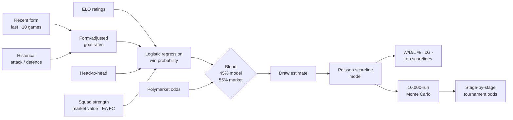
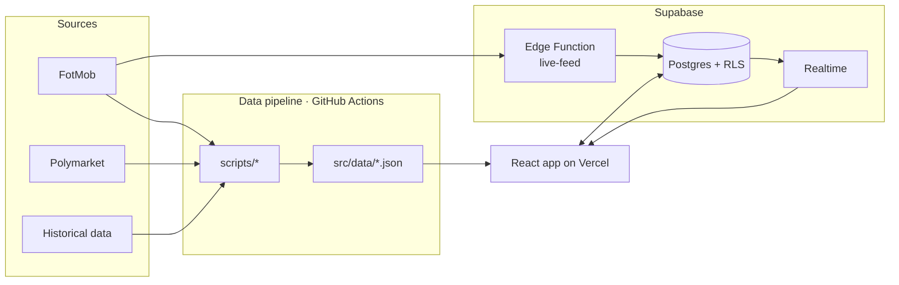

WORLD CUP 2026!!!!!!!!!!!!!!!!!!!!!!!!!!!!!!!!!!!!!!!
<div align="center">

# ⚽ World Cup 2026 Predictor

**A full-stack prediction game for the FIFA World Cup 2026, powered by a statistical model that blends ELO ratings, Poisson scoreline modeling, logistic regression and live prediction-market odds.**


[**Live demo**]https://worldcup26-lemon-five.vercel.app/· [Architecture](docs/ARCHITECTURE.md) · [Model](#-the-prediction-model) · [Results](#-how-it-performed)

<!-- Add 1–2 screenshots here: the match prediction card and a league leaderboard -->
<!--  -->

</div>

---

## Overview

Players pick the outcome of every World Cup match, build a knockout bracket, and compete on public or private league leaderboards. Every fixture shows the model's own forecast — win/draw/loss probabilities, the most likely scoreline, and expected goals — so users can play with or against it.

**120+ users across 8 leagues** played through the 2026 tournament.

### Features

- **Match predictions** for all 104 fixtures with win/draw/loss probabilities, expected goals and the three most likely scorelines
- **Full tournament simulator** — 10,000-run Monte Carlo giving every team's probability of reaching each stage
- **Bracket builder** covering the new 48-team format, including best-third-place qualification
- **Leagues** — public and private, with invite links and join codes
- **Confidence multipliers** (×1 / ×2 / ×3) and correct-pick **streaks**
- **Live match centre** — goals, cards and subs pushed in real time
- **Pick locking at kickoff**, enforced by a database trigger, not just the UI
- **Auth** via email/password, magic link or Google OAuth

---

## 🧠 The prediction model



**1. Win probability — logistic regression.** Trained in `scripts/train_model.py` on 2,448 internationals since 2000 between World Cup nations (draws excluded, so it learns a clean win/loss signal). Features:

| Feature | What it captures |
|---|---|
| `elo_diff` | Overall team strength (difference ÷ 100) |
| `atk_diff` / `def_diff` | Goals scored and conceded, shrunk toward the mean for small samples and nudged by recent form |
| `h2h_centered` | Head-to-head record (when ≥ 2 meetings) |
| `squad_diff` | Squad-strength index, falling back to player market values, then EA FC ratings (fixed weight, not trained) |

A home-advantage term applies in the group stage; knockout games are treated as neutral venues.

**2. Market blend.** For group-stage fixtures with Polymarket coverage, the model's probability is blended **45% model / 55% market**. Markets aggregate information a model can't see (injuries, lineups, sentiment); the model fills in where markets are thin or absent, including every knockout match.

**3. Draws and scorelines — Poisson.** A draw probability is estimated from each team's historical draw rate, shrinking as the matchup gets more lopsided. Expected goals for each side are derived from the adjusted attack/defence rates, scaled to agree with the win probability, and a Poisson model produces the full scoreline distribution.

**4. Tournament simulation.** `TournamentSimulator.js` plays the entire tournament — group tables, the eight best third-placed teams, Round of 32 through the final — sampling every match from the same Poisson engine. Repeating it 10,000 times gives each team's probability of reaching every round.

---

## 📊 How it performed

To keep the evaluation honest, `scripts/snapshotPredictions.mjs` **freezes each prediction before kickoff** and never overwrites it, so nothing is graded with hindsight. Results below cover the 72 group-stage matches, scored with one pick per match (the most likely outcome).

| Metric | Model | Polymarket favourite |
|---|---|---|
| Outcome accuracy (W/D/L) | **65.3%** (47/72) | 65.3% (47/72) |
| Exact scoreline | **9.7%** (7/72) | — |
| Brier score (lower is better) | 0.509 | 0.498 |
| Log loss (lower is better) | 0.873 | 0.848 |

**Takeaways**

- The model **matched the prediction market's favourite** on outcome accuracy. The two agreed on 68 of 72 matches, which is expected given the 55% market weighting.
- The market was slightly better calibrated on probabilities, so the blend is doing its job: deferring to the market where it's strong.
- The model never picks a draw as its single most likely outcome, and the group stage produced 20 draws. Improving draw prediction is the clearest next step.

Knockout matches aren't included because pre-kickoff snapshots only exist for the group stage.

---

## 🏗️ Architecture



- **Frontend** — React + Vite + Tailwind on Vercel. The model runs entirely in the browser from pre-built JSON.
- **Data pipeline** — scripts pull form, squads, player stats and odds; scheduled GitHub Actions refresh the data daily/weekly, commit it, and trigger a redeploy.
- **Live scores** — a Supabase Edge Function polls FotMob every minute during matches (via `pg_cron`) and streams updates to clients over Realtime.
- **Security** — every table has row-level security; the service-role key never reaches the browser; locked picks are protected by a database trigger.
- **CI** — lint, unit tests (Vitest) and a production build on every pull request; Dependabot keeps dependencies current.

Full details: [`docs/ARCHITECTURE.md`](docs/ARCHITECTURE.md).

---

## 🚀 Running locally

**Prerequisites:** Node 22, Python 3.10+, a Supabase project.

```bash
git clone https://github.com/TheCoolKar/world-cup-predictor.git
cd world-cup-predictor
npm install
```

Create a `.env` file in the project root:

```bash
VITE_SUPABASE_URL=https://<your-project>.supabase.co
VITE_SUPABASE_ANON_KEY=<anon-key>
VITE_APP_URL=http://localhost:5173

# Only needed for the data scripts
SUPABASE_SERVICE_KEY=<service-role-key>
VITE_API_FOOTBALL_KEY=<api-football-key>
```

Set up the database by running `supabase_setup.sql`, then the files in `supabase/migrations/` in order. Then:

```bash
npm run dev       # start the app at localhost:5173
npm test          # run unit tests
```

### Data scripts

| Command | What it does |
|---|---|
| `npm run train-model` | Retrain the logistic regression and write `model_weights.json` |
| `npm run fetch-odds` | Pull the latest Polymarket odds |
| `npm run fetch-form` | Update each team's recent form |
| `npm run build-squad-strength` | Rebuild squad-strength ratings |
| `npm run sim` | Run the 10,000-iteration Monte Carlo |
| `npm run snapshot-predictions` | Freeze predictions for matches that have kicked off |
| `npm run refresh:daily` | Form update + simulation (what CI runs daily) |

---

## 📁 Project structure

```
├── scripts/            # Data pipeline: fetching, model training, simulation
├── src/
│   ├── components/     # UI components (match cards, bracket, leaderboard…)
│   ├── pages/          # Routes
│   ├── utils/          # Prediction model, tournament simulator, scoring
│   ├── data/           # Model inputs and outputs (JSON, built by scripts/)
│   └── hooks/          # Auth, live feed
├── supabase/
│   ├── functions/      # Edge Functions (live feed, account deletion)
│   └── migrations/     # Numbered SQL migrations
├── docs/               # Architecture and runbooks
└── .github/workflows/  # CI and scheduled data refresh
```

---

## Disclaimer

Predictions are for entertainment only. Not affiliated with FIFA. Live data comes from FotMob's unofficial API, and market odds from Polymarket.